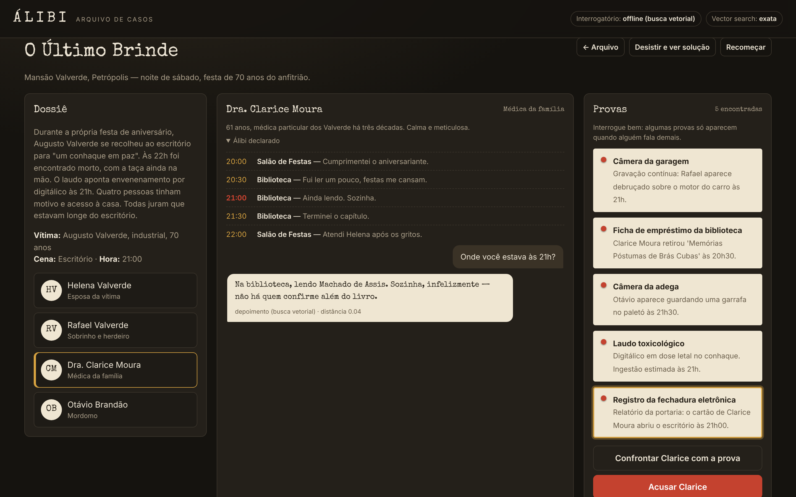

# Como jogar

## Subir

```bash
git clone https://github.com/edermendes2016/API.NET-11.git
cd API.NET-11
docker compose up
```

Abra http://localhost:8080. Na primeira subida o SQL Server leva uns 30 segundos; a API espera ele ficar saudável, cria o banco com as migrations e carrega os 3 casos.

| Endereço | O que é |
|---|---|
| http://localhost:8080 | O jogo |
| http://localhost:8080/docs | Referência da API (Scalar) |
| http://localhost:8080/openapi/v1.json | Documento OpenAPI |

Para mexer no frontend sem Docker, rode a API com `dotnet run --project src/Alibi.Api` (porta 5165) e use o servidor do Vite, que repassa `/api` para ela:

```bash
cd src/Alibi.Web
npm install
npm run dev
```

Variáveis opcionais: `ANTHROPIC_API_KEY` (liga a IA), `ANTHROPIC_MODEL` (padrão `claude-opus-5-5`) e `SA_PASSWORD`.

## Regras

1. **Leia o dossiê.** Vítima, cena e hora do crime (sempre 21h).
2. **Interrogue.** Escreva qualquer pergunta ou use as sugestões. Algumas respostas revelam provas novas no quadro.
3. **Confronte.** Selecione uma prova e confronte um suspeito. O resultado é um dos quatro desfechos da union `AccusationResult`.
4. **Acuse.** Acuse o culpado apresentando a prova que derruba o álibi dele no horário do crime.

| Desfecho | Significado |
|---|---|
| `CaseSolved` | Culpado certo e prova da mentira no horário do crime |
| `ContradictionFound` | O suspeito mentiu, mas isso sozinho não fecha o caso |
| `AlibiHolds` | A prova confirma o depoimento |
| `InsufficientEvidence` | A prova não diz nada sobre esse suspeito |

Cuidado: em cada caso há inocentes que mentem para esconder outra coisa.



## Os casos

| Caso | Dificuldade | Cenário |
|---|---|---|
| O Último Brinde | Fácil | Mansão em Petrópolis, festa de 70 anos |
| A Última Cena | Médio | Teatro Municipal, estreia de Hamlet |
| Sinal Perdido | Difícil | Observatório na Serra da Mantiqueira |

"Desistir e ver solução" mostra o culpado e a tabela completa do cruzamento.
