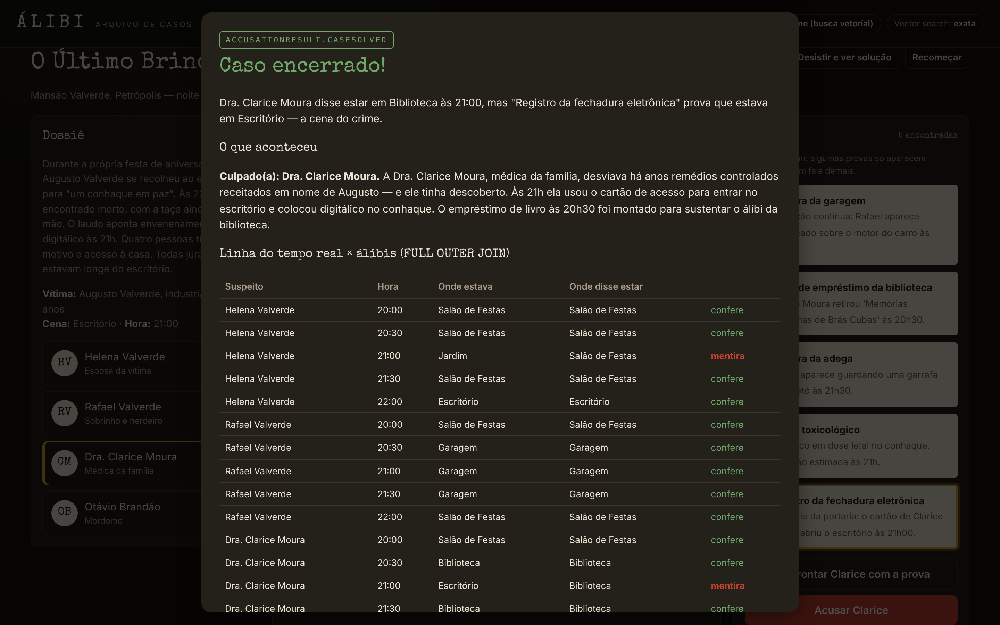

# FullJoin no EF Core 11

O coração do jogo é comparar duas versões da noite:

- `Timeline`: onde o suspeito **estava** (verdade, nunca exposta)
- `Alibis`: onde o suspeito **disse** que estava

Um INNER JOIN perderia exatamente os casos interessantes. Com FULL OUTER JOIN aparecem também:

- **omissão**: horário que existe na verdade e não no álibi (o suspeito "não lembra")
- **invenção**: horário que o suspeito declarou e não aconteceu

## O código

```csharp
var truth  = db.Timeline.Where(t => t.CaseId == caseId);
var claims = db.Alibis.Where(a => a.CaseId == caseId);

return truth.FullJoin(
    claims,
    t => new { t.SuspectId, t.Time },
    a => new { a.SuspectId, a.Time },
    (t, a) => new CrossCheckProjection
    {
        SuspectId       = t != null ? t.SuspectId : a!.SuspectId,
        Time            = t != null ? t.Time : a!.Time,
        RealLocation    = t != null ? t.Location : null,
        ClaimedLocation = a != null ? a.ClaimedLocation : null,
        ClaimedStatement = a != null ? a.Statement : null,
    });
```

`src/Alibi.Infrastructure/Persistence/CaseQueries.cs`

`FullJoin` é um operador LINQ do próprio .NET (`System.Linq.Queryable`), e o EF Core 11 sabe traduzi-lo. A chave composta (suspeito + horário) funciona com tipo anônimo.

## SQL gerado

Capturado pelo teste `FullJoin_is_translated_to_FULL_JOIN` com `ToQueryString()`:

```sql
SELECT CASE
    WHEN [t0].[Id] IS NOT NULL THEN [t0].[SuspectId]
    ELSE [a0].[SuspectId]
END AS [SuspectId], CASE
    WHEN [t0].[Id] IS NOT NULL THEN [t0].[Time]
    ELSE [a0].[Time]
END AS [Time], [t0].[Location] AS [RealLocation], [a0].[ClaimedLocation], [a0].[Statement] AS [ClaimedStatement]
FROM (
    SELECT [t].[Id], [t].[Location], [t].[SuspectId], [t].[Time]
    FROM [Timeline] AS [t]
    WHERE [t].[CaseId] = @caseId
) AS [t0]
FULL JOIN (
    ...
```

## Pegadinha encontrada

Ordenar por uma propriedade de um **record construído** no seletor (`OrderBy(r => new TimelineRow(...).SuspectId)`) não traduz. A solução foi projetar para uma classe com setters (`CrossCheckProjection`), ordenar no SQL e só depois converter para o record do domínio.

## Como o jogo usa

Ao apresentar uma prova (suspeito X estava no local Y às HH:mm), `Investigation.Evaluate` procura a linha do FULL JOIN daquele horário:

| Linha do cruzamento | Resultado |
|---|---|
| Real = prova, declarado = prova | `AlibiHolds` |
| Real = prova, declarado ≠ prova | `ContradictionFound` (ou `CaseSolved`) |
| Real = prova, sem declaração | `ContradictionFound` (omissão) |
| Prova não é sobre o acusado | `InsufficientEvidence` |

Ao resolver o caso, a tabela inteira aparece na tela:


