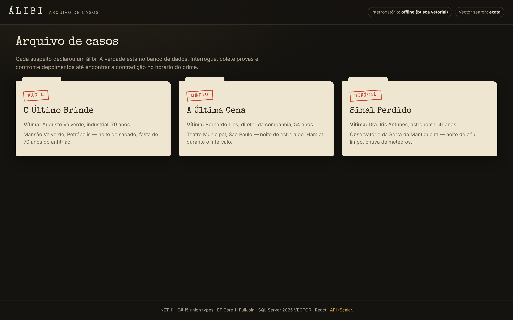

# Álibi: jogo de investigação em .NET 11

Um mistério no estilo Detetive. Cada suspeito declarou onde estava a cada meia hora da noite do crime. A verdade está gravada no SQL Server. O jogador interroga, coleta provas e confronta depoimentos até achar a mentira que importa: a do horário do crime.

## Por onde começar

| Página | Para quê |
|---|---|
| [[Como jogar]] | Subir com Docker e resolver o primeiro caso |
| [[Arquitetura]] | Camadas, modelo de dados e fluxo de uma acusação |
| [[Union types]] | C# 15: o resultado da acusação como union |
| [[FullJoin no EF Core 11]] | Linha do tempo real × álibis declarados |
| [[Busca vetorial]] | SQL Server 2025 `VECTOR`, `VectorSearch` e o fallback exato |
| [[Interrogatório com IA]] | Claude via `IChatClient` e o modo offline |
| [[Criando um caso]] | Formato JSON para adicionar novos mistérios |
| [[Testes e CI]] | O que é testado e como |

## Stack

.NET 11 (SDK 11.0.100) · C# 15 · ASP.NET Core Minimal APIs · EF Core 11 · SQL Server 2025 · Anthropic C# SDK + Microsoft.Extensions.AI · xUnit · Docker Compose · GitHub Actions
