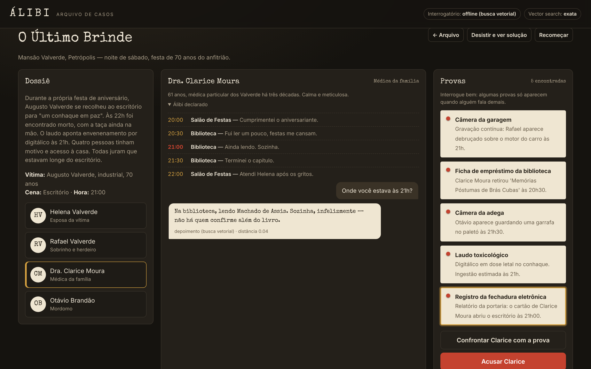

# Álibi: jogo de investigação em .NET 11

Um mistério no estilo Detetive: cada suspeito declarou um álibi e a verdade está no SQL Server. Você interroga os suspeitos, coleta provas e confronta depoimentos até achar a contradição no horário do crime.



## Rodar (zero configuração)

```bash
docker compose up
```

Abra **http://localhost:8080**. Sobem a API .NET 11, o SQL Server 2025 e 3 casos prontos para jogar. A documentação da API fica em `/docs`.

Opcional: com `ANTHROPIC_API_KEY=...` no ambiente, os suspeitos respondem com IA (Claude). Sem a chave, o jogo roda 100% offline.

## O que o projeto mostra

| Recurso | Onde |
|---|---|
| **C# 15 union types** | `AccusationResult(CaseSolved, AlibiHolds, ContradictionFound, InsufficientEvidence)` |
| **EF Core 11 `FullJoin`** | linha do tempo real × álibis declarados, traduzido para `FULL JOIN` |
| **SQL Server 2025 `VECTOR`** | busca das falas dos suspeitos por similaridade |
| **IA com `IChatClient`** | interrogatório com Claude, com alternativa offline |

Stack: .NET 11, ASP.NET Core Minimal APIs, EF Core 11, SQL Server 2025, xUnit, Docker.

## Documentação

Detalhes de arquitetura, de cada recurso do .NET 11 e de como criar um caso novo estão na **[wiki](../../wiki)**.

## Testes

```bash
dotnet test
```

Licença MIT.
